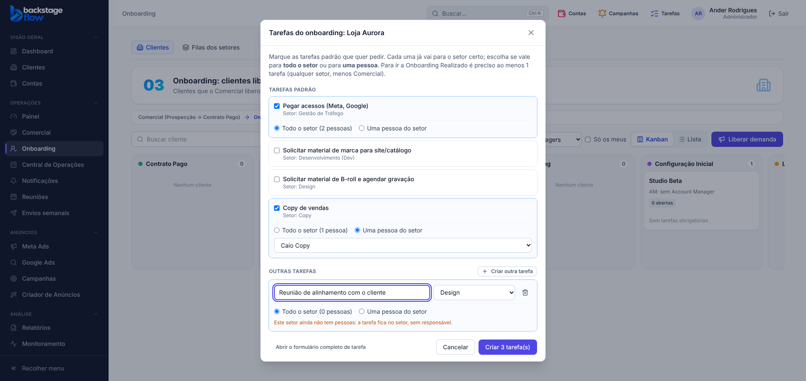
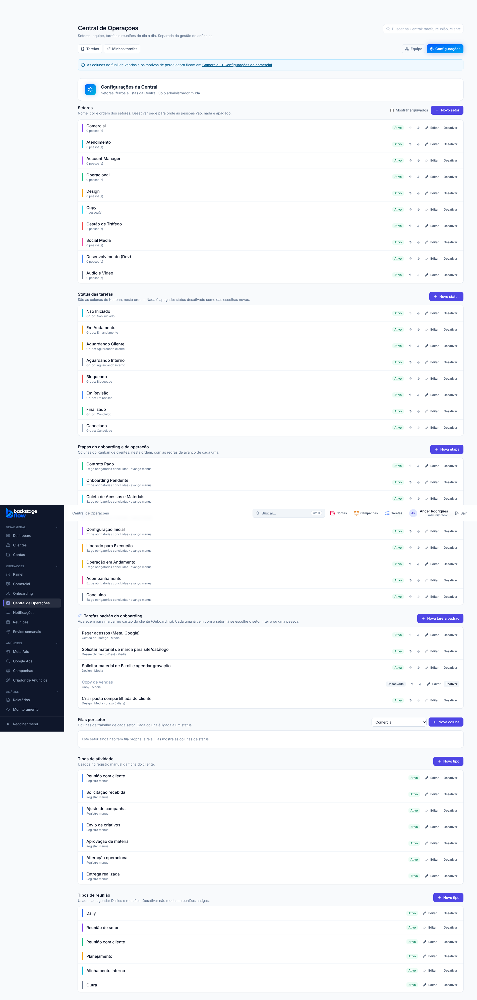

# 50.1 — Tarefas padrão do onboarding (07/11/2026)

Refeita a pedido do Ander, de forma mais simples e organizada (substitui o botão "Criar tarefa para a operação" da 49.4, que criava uma tarefa do zero).

## Como funciona
1. **Cartão do cliente → botão "Tarefas do onboarding"** (aparece em *Onboarding Agendado* ou com a reunião já realizada, para quem pode criar tarefas).
2. A janela mostra as **tarefas padrão** já com o **setor definido**, todas **desmarcadas**: é só marcar as que quer.
   - Pegar acessos (Meta, Google) → Gestão de Tráfego
   - Solicitar material de marca para site/catálogo → Desenvolvimento (Dev)
   - Solicitar material de B-roll e agendar gravação → Design
   - Copy de vendas → Copy
3. Em **cada tarefa marcada** (padrão ou nova) escolhe-se quem recebe, dentro do setor:
   - **Todo o setor:** uma única tarefa com **todas as pessoas do setor marcadas** (a primeira como principal, as demais como participantes);
   - **Uma pessoa do setor:** escolhe o colaborador na lista.
4. **"Criar outra tarefa"**: se nenhuma padrão serve, cria uma nova na hora (título + setor, sem Comercial) com a mesma escolha de setor inteiro/pessoa. O link "Abrir o formulário completo de tarefa" leva ao formulário completo de antes (prazo, tags, anexos).
5. Quem não tem a permissão de atribuir pessoas cria as tarefas no setor, sem escolher pessoas.
6. A regra da 49.4 não mudou: para ir a *Onboarding Realizado* precisa de ao menos 1 tarefa (qualquer setor, menos Comercial) além da reunião realizada.

## Cadastro (Central de Operações → Configurações → "Tarefas padrão do onboarding", só administrador)
Criar nova, editar (título, descrição, setor, prioridade, prazo em dias), **reordenar**, **desativar/reativar**. Nada é apagado.

## Tabela nova: `ops_onboarding_task_templates`
- **Para quê:** guardar as tarefas padrão oferecidas no onboarding.
- **Campos principais:** título, descrição, setor, prioridade, prazo em dias (opcional), posição, ativa, quem criou, datas.
- **Ligações:** setor (`ops_sectors`) e quem criou (usuário). **Índices:** por setor e por quem criou.
- **Segurança:** RLS ligado; quem tem acesso à Central lê; só o administrador altera (funções `ops_onboarding_template_save`, `_set_active`, `_reorder`, com registro de auditoria).
- **Por quanto tempo:** enquanto a Central existir; desativar não apaga, e as tarefas já criadas a partir delas continuam normais.
- Vem com as 4 tarefas acima (descrições editáveis).
- Migração: `supabase/migrations/20261107125640_onboarding_tarefas_padrao.sql`.

## Testes
- SQL `supabase/tests/etapa50_1_tarefas_padrao.sql`: 4 verificações OK no banco real (seed, não-admin barrado, validações, desativar, reordenar, auditoria). Advisors sem novidades.
- Navegador `onboarding-reuniao.mjs` (32 verificações, 10 novas da 50.1) + `ops-clients`, `ops-commercial`, `ops-tasks`, `ops-team`, `ops-separados` OK; unitários e `check:secrets` OK.
- **Não testado:** celular; sem pessoas no setor (aviso na tela, só visto no simulador).
