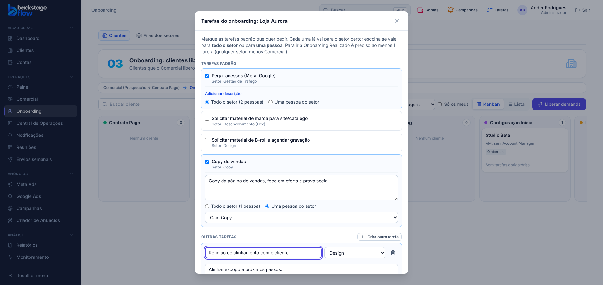

# 50.2 — Descrição nas tarefas do onboarding (07/11/2026)

Pedido do Ander: na criação de tarefas (e nas padrão) deixar o **título** e um campo **maior de descrição**; nas padrão, a descrição vira **opção**.

## O que mudou (janela "Tarefas do onboarding")
- **Tarefa nova ("Criar outra tarefa"):** título + **campo de descrição maior** (já aberto), setor e quem recebe.
- **Tarefa padrão:** ao marcar, aparece o link **"Adicionar descrição"** (ou "Editar descrição" se a padrão já tem uma, cadastrada em Configurações). Ao clicar abre o campo de descrição, já com o texto padrão para você ajustar. Sem clicar, vai a descrição padrão cadastrada.
- A descrição vai para a tarefa criada (visível na tarefa). Sem mudança de banco.

## Testes
`onboarding-reuniao` (3 verificações novas), `ops-clients`, `ops-tasks`, unitários e `check:secrets` OK. Corrigido no caminho um defeito de foco (o campo perdia o cursor a cada letra) antes de entregar. **Não testado:** celular.
