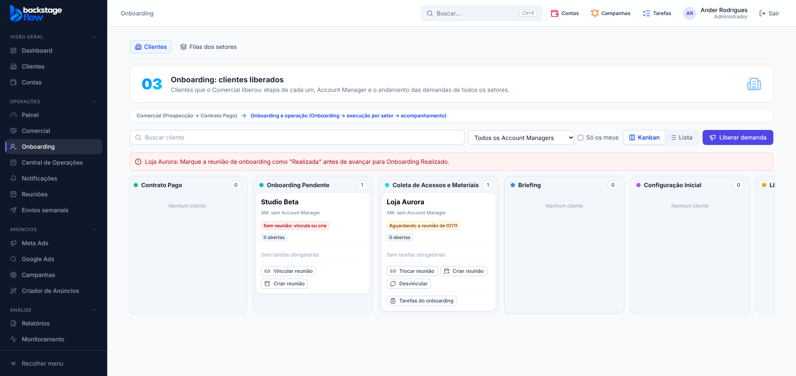

# 50.4 — Nome do cliente em evidência nos cartões (07/11/2026)

Pedido do Ander: nos cartões, o **nome do cliente** deve ficar em evidência.

## O que mudou (só visual, Onboarding)
- O nome do cliente nos cartões do Kanban de Onboarding agora é **maior e em negrito** (antes era do mesmo tamanho dos detalhes), com quebra de linha para nomes longos.
- A linha do Account Manager ficou menor, para não competir com o nome.
- Sem mudança de banco, regras ou permissões.

Obs.: os cartões do **Comercial** mostram o nome da empresa do lead; se quiser o mesmo destaque lá, é só pedir.

## Testes
`onboarding-reuniao`, `ops-clients` (ajustado para o novo identificador do nome), `ops-commercial`, `ops-tasks`, unitários e `check:secrets` OK.
