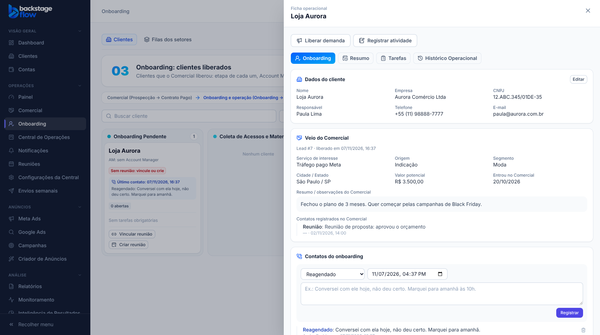

# 51.1 — Ficha do cliente no Onboarding (07/11/2026)

## Pedido do Ander
Na primeira etapa do Onboarding, a ficha do cliente precisa ter: os **dados do cliente** (vindos do Comercial ou digitados, quando ele entra direto), um **resumo do que veio alinhado do Comercial**, um **registro de contatos do onboarding** igual ao do Comercial (48.1), por exemplo "conversei hoje, não deu certo, marquei para amanhã", e um campo de **Observações**. Depois disso continuam as regras de reunião e de tarefa (47.2 e 49.4).

Decisões do Ander:
1. O resumo do Comercial aparece para **todos que veem o cliente no Onboarding**.
2. Cadastrar cliente novo direto no onboarding: **administrador, gestor e Account Manager**.

## O que mudou
- **Aba nova "Onboarding"** na ficha do cliente; a ficha abre nela. As abas Resumo, Tarefas e Histórico Operacional continuam iguais.
  1. **Dados do cliente:** nome, empresa, CNPJ (aceita o formato com letras), responsável, telefone e e-mail, com **Editar**. É o mesmo cadastro de Clientes: nada é duplicado.
  2. **Veio do Comercial:** número do lead, quem vendeu, serviço de interesse, origem, segmento, cidade, valor potencial, as observações do lead e os contatos registrados no Comercial (mais recente primeiro). Cliente que entrou direto mostra "Entrou direto no onboarding (sem passar pelo Comercial)".
  3. **Contatos do onboarding:** registro rápido com tipo (Contato realizado, Não atendeu, Reagendado, Reunião, Observação), "quando" e o texto. Mais recente primeiro. Quem registrou (ou um administrador) pode retirar.
  4. **Observações:** texto livre do cliente, com "Salvar observações". Mostra quem alterou por último.
- **Cartão do cliente no quadro:** bloco **"Último contato: dd/mm/aaaa hh:mm"** com o tipo e o texto. Sem registro: "Nenhum contato registrado".
- **Botão "Cliente novo"** no Onboarding: cadastra o cliente (com os dados acima) e já coloca no onboarding. Confere nome e CNPJ repetidos, como a conversão do Comercial. "Colocar cliente no fluxo" (cliente que já existe no cadastro) continua igual.

## Regras
- **Ver a aba:** quem vê o cliente no Onboarding (ficha operacional ou Account Manager dele).
- **Editar os dados:** administrador, gestor, o Account Manager do cliente ou quem gerencia clientes na Central.
- **Registrar contato:** quem pode mover o cliente ou tem "registrar atividades".
- **Observações:** quem pode mover o cliente.
- **Cliente novo:** administrador, gestor (com acesso à Central) ou Account Manager. "Account Manager" = quem já é AM de algum cliente **ou** está no setor "Account Manager" (reconhecido pelo nome do setor). Quem não gerencia clientes vira o AM do cliente que cadastrou, para continuar vendo o cliente.
- **Telefone e CNPJ** seguem as regras do cadastro: telefone com DDD vira 55 + DDD + número; CNPJ é conferido pelo dígito (numérico ou com letras).
- **Privacidade:**
  - telefone, e-mail e CNPJ do cliente só saem por uma função própria do site (`ops_client_data_get`); a ficha geral, que o Claude (MCP) lê, não tem esses dados;
  - o resumo do Comercial não traz contato, telefone, e-mail nem CNPJ do lead;
  - no histórico, a edição dos dados guarda **só os nomes dos campos** alterados, nunca os valores.

## Tabela nova
| Tabela | Para quê | Campos principais | Ligações | Índices | Por quanto tempo |
|---|---|---|---|---|---|
| `ops_client_onb_contacts` | Contatos do onboarding do cliente | `kind` (contato, nao_atendeu, reagendado, reuniao, observacao), `body` (3 a 5.000 letras), `happened_at`, `created_by`, `removed_at`/`removed_by` | `client_id` → clientes; pessoas → usuários | cliente + data; quem registrou; quem retirou | **Permanente.** Retirar só marca `removed_at` (some da tela, não é apagado). Leitura pelo site conforme quem vê o cliente; gravação só pelas funções. |

Campos novos em `ops_client_ops`: `onboarding_notes` (até 10.000 letras), `onboarding_notes_at`, `onboarding_notes_by`. Cada alteração das observações fica no histórico do cliente (`cliente.observacoes`, com o texto anterior e o novo), também permanente.

## Banco
Migração `supabase/migrations/20261107163156_onboarding_ficha_do_cliente.sql`. Funções novas: `ops_client_data_get`, `ops_client_data_save`, `ops_client_create_start`, `ops_client_onb_contact_add`, `ops_client_onb_contact_remove`, `ops_client_onb_notes_save` (cada uma com sua `_impl`), além das internas `ops_is_account_manager`, `ops_can_create_client`, `ops_can_edit_client_data` e `ops_client_data_clean`. Alteradas: `ops_client_get_impl` (bloco `onboarding` e permissões `contact`/`edit_data`) e `ops_client_board_impl` (`last_contact` e `can.create_client`). Remoção: seção nova no início de `supabase/rollback/remover_central_operacoes.sql`.

## Testes
- SQL `supabase/tests/etapa51_1_onboarding_ficha.sql`: **9 verificações OK** no banco real (transação desfeita). Inclui: recusa sem ser AM, cadastro pelo AM do setor, nome repetido, telefone inválido, CNPJ com letras, histórico sem dados pessoais, ficha geral sem telefone/e-mail, contatos (ordem, retirar marca e não apaga), observações com controle de versão, resumo do lead sem contato, tabela sem gravação direta.
- Navegador `onboarding-ficha.mjs` (novo, **26 verificações**) e `ops-clients.mjs` ajustado (a ficha agora abre na aba Onboarding).
- Tipos, lint, unitários e `check:secrets` OK; avisos de segurança do Supabase só os antigos.
- **Não testado:** o trecho novo do script de remoção (a ferramenta do banco trava com `DROP`; precisa do SQL Editor) e o visual no celular.
