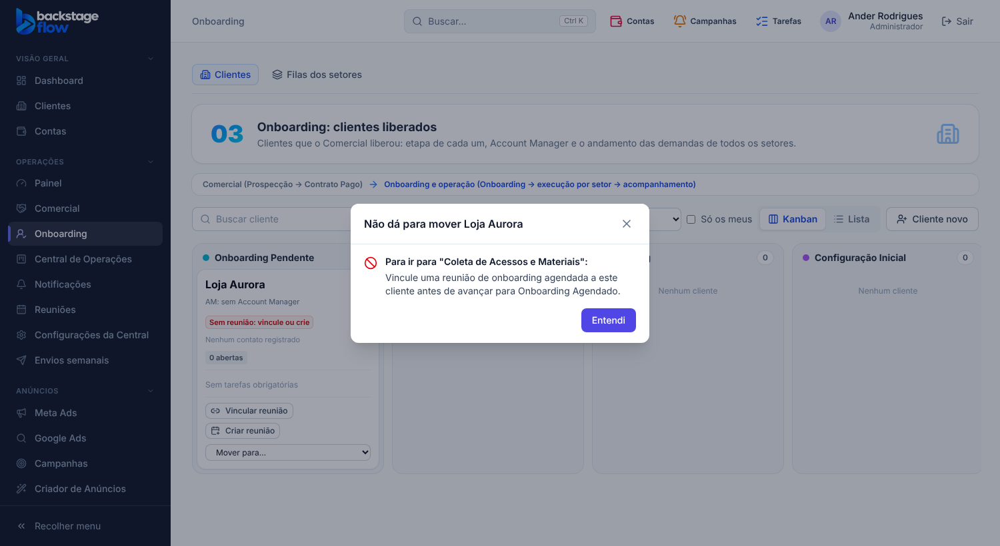

# 51.2 — Onboarding enxuto e "Mover para…" com pop-up da regra (07/11/2026)

## Pedido do Ander
No Onboarding, tirar **Liberar demanda**, **Registrar atividade**, **Resumo** e **Tarefas**. No quadro, além de arrastar, poder **escolher para qual coluna** mandar o cartão. Se alguma regra não deixar o cartão avançar, abrir um **pop-up** explicando a regra. As regras que já existem continuam iguais.

## O que mudou
- **Ficha do cliente no Onboarding:** só as abas **Onboarding** e **Histórico Operacional**. Saíram os botões "Liberar demanda" e "Registrar atividade" e as abas "Resumo" e "Tarefas".
- **Quadro do Onboarding:** saiu o botão "Liberar demanda". Ficam "Colocar cliente no fluxo" e "Cliente novo".
- **"Mover para…" no cartão** (para quem pode mover o cliente): lista das colunas ativas; escolher uma faz o mesmo que arrastar.
- **Pop-up "Não dá para mover {cliente}"** ao arrastar ou ao escolher no "Mover para…", com a coluna de destino e a regra (ex.: vincular reunião agendada, marcar a reunião como Realizada, criar a tarefa para a operação, tarefas obrigatórias abertas). Botão "Entendi"; o cartão continua onde estava. Antes, a recusa aparecia numa linha vermelha acima do quadro.
- **Onde ficam as funções retiradas:** "Liberar demanda", "Registrar atividade", Resumo e Tarefas continuam na ficha do cliente no cadastro (Clientes → cliente → abas Tarefas / Histórico Operacional). Nada foi apagado.

## Regras
Sem mudança: Agendado exige reunião agendada; Realizado exige reunião Realizada e ao menos 1 tarefa para a operação; Cancelado é livre; obrigatórias abertas impedem o avanço; voltar é livre.

## Banco
Sem mudança no banco (só telas).

## Testes
- Navegador: `ops-clients` (41, refeito: liberar demanda e registrar atividade pela ficha do cadastro; pop-up ao arrastar e pelo "Mover para…"; ficha do Onboarding só com Onboarding e Histórico), `onboarding-reuniao` (35, fecha o pop-up a cada recusa), `onboarding-ficha` (23), `ops-kanban-touch` (3), `ops-separados` (13), `ops-commercial` (38), `ops-tasks` (37).
- Tipos, lint, unitários (web 179, shared 275) e `check:secrets` OK.
- Não testado: visual no celular.
