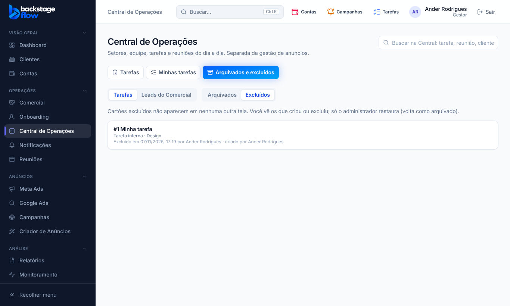

# 51.3 — Arquivar e excluir cartões; aba "Arquivados e excluídos" (07/11/2026)

## Pedido do Ander
Cada pessoa pode **arquivar** os cartões que vieram para ela (repassados) e **excluir** os cartões que ela mesma criou. Um lugar separado para ver os **arquivados** e os **excluídos**. O tempo de guarda no banco será decidido depois.

Decisões: vale para **tarefas da Central e leads do Comercial**; excluir **não apaga do banco** (some das telas e fica guardado; só o administrador restaura).

## Regras
| | Tarefas da Central | Leads do Comercial |
|---|---|---|
| **Arquivar / desarquivar** | quem criou, quem está na tarefa (responsável principal ou adicional), quem tem "Arquivar tarefas" e o administrador | quem criou, o responsável comercial do lead e o administrador |
| **Excluir** | só quem criou (e o administrador) | só quem criou (e o administrador); **lead que já virou cliente não pode ser excluído** (só arquivado) |
| **Restaurar** | só o administrador | só o administrador |

- **Excluir** pede confirmação. O cartão some de **todas** as telas (listas, quadro, Minhas tarefas, busca, ficha do cliente, painel, contas do onboarding, Claude/MCP) e também fica marcado como arquivado. O histórico guarda "tarefa.excluida" / "lead.excluido".
- **Restaurar** devolve o cartão como **arquivado**; desarquivar é um passo à parte.
- **Mudança de regra:** antes, arquivar tarefa exigia "Arquivar tarefas" (só 1 pessoa tinha) e qualquer pessoa do Comercial arquivava qualquer lead. Agora vale a tabela acima.

## Na tela
- Ficha da tarefa e ficha do lead: botão **Excluir** (com confirmação) para quem criou; **Arquivar** aparece só para quem pode.
- Central de Operações → nova aba **"Arquivados e excluídos"**: escolha **Tarefas** ou **Leads do Comercial** (este só para quem tem o Comercial) e **Arquivados** ou **Excluídos**.
  - Arquivados: quem arquivou e quando, quem criou; botões **Desarquivar** e **Excluir** conforme a regra; clicar abre a tarefa ou o lead.
  - Excluídos: quem excluiu e quando, quem criou; cada pessoa vê os que **criou ou excluiu**; o administrador vê todos e tem **Restaurar**.

## Banco
Sem tabela nova. Colunas novas:
| Tabela | Colunas | Para quê | Por quanto tempo |
|---|---|---|---|
| `ops_tasks` | `deleted_at`, `deleted_by` | marca a tarefa excluída e quem excluiu | **permanente até o Ander definir o prazo** (pendência registrada) |
| `ops_leads` | `archived_by`, `deleted_at`, `deleted_by` | quem arquivou; lead excluído e quem excluiu | idem |

Índices em `deleted_by`, `archived_by` e índice parcial dos excluídos. Funções novas: `ops_task_delete`, `ops_task_restore`, `ops_lead_delete`, `ops_lead_restore`, `ops_archive_list` (cada uma com `_impl`), regras `ops_can_archive_task/delete_task/archive_lead/delete_lead`. Alteradas: `ops_task_visible` (excluída não é vista por ninguém), `ops_task_archive_impl`, `ops_lead_archive_impl`, `ops_lead_board_impl` e `ops_lead_duplicates_impl` (ignoram excluídos); `ops_task_get` e `ops_lead_get` passam por `*_get_v2_impl` (permissões `archive`/`delete`; lead excluído não abre). Migração `supabase/migrations/20261107171544_arquivar_excluir_cartoes.sql`. Remoção: seção no início de `supabase/rollback/remover_central_operacoes.sql`.

## Testes
- SQL `supabase/tests/etapa51_3_arquivar_excluir.sql`: **8 verificações OK** no banco real (transação desfeita).
- Navegador `arquivar-excluir.mjs` (novo, **15 verificações**), `ops-separados` ajustado (aba nova). Conjunto completo de navegador: 74 de 77; `ops-team` e `ops-tasks` ajustados às regras novas e `ads-builder` passou ao repetir (ver 51.4).
- Tipos, lint, unitários e `check:secrets` OK; avisos de segurança do Supabase só os antigos.
- Não testado: o trecho novo do script de remoção (a ferramenta do banco trava com `DROP`) e o visual no celular.
