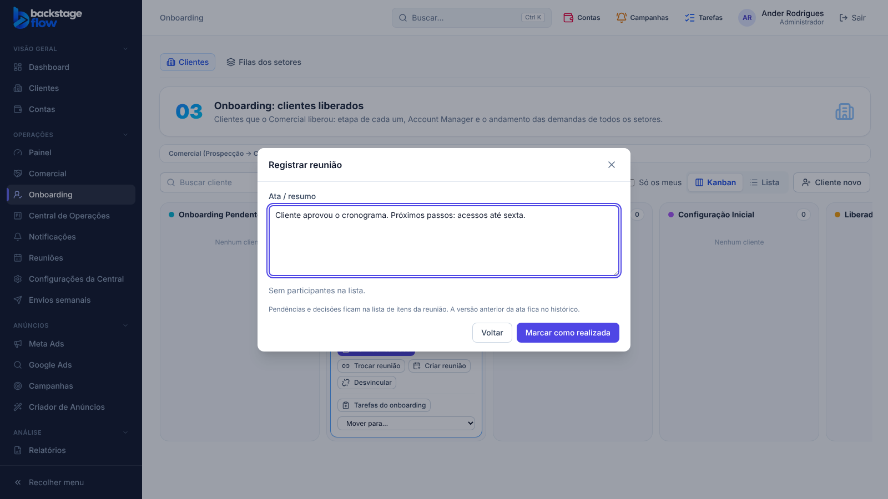

# 51.4 — "Reunião realizada" no cartão do Onboarding (07/11/2026)

## Pedido do Ander
No cartão com reunião agendada, um botão "Reunião realizada", o mesmo do menu Reuniões, para o Account Manager registrar a reunião sem sair do Onboarding: abre a janela, ele finaliza, a janela fecha e ele continua no Onboarding.

## O que mudou
- Cartão do Onboarding com reunião de onboarding **agendada**: botão **"Reunião realizada"** (primeiro dos botões de reunião).
- O botão abre a **mesma janela do menu Reuniões** ("Registrar reunião": ata/resumo, presença e "Marcar como realizada").
- Ao salvar, a janela fecha, a pessoa continua no Onboarding e o cartão atualiza (selo "Reunião realizada #N", e o pedido da tarefa para a operação da 49.4, se faltar).
- Quem pode: o mesmo do menu Reuniões (quem organiza a reunião ou tem "Criar reuniões e Dailies"). Para quem não pode, aparece o aviso no cartão.
- A janela não inicia o arrastar do cartão (selecionar texto na ata não move o cartão).
- As regras de passagem não mudaram: registrar a reunião não muda o cartão de coluna sozinho.

## Banco
Sem mudança (usa `ops_meeting_get` e `ops_meeting_record`).

## Testes
- Navegador `onboarding-reuniao-realizada.mjs` (novo, 6 verificações) e, de novo, `onboarding-reuniao` (35), `onboarding-ficha` (23), `ops-clients` (41), `ops-meetings` (31).
- Conjunto completo de navegador da 51.3: 74 de 77 passaram; as 3 falhas foram corrigidas e passam: `ops-team` e `ops-tasks` (testes ajustados às regras novas da 51.3: aba nova e responsável pode arquivar) e `ads-builder` (passou ao repetir, 35 verificações; falha passageira, não ligada a estas etapas).
- Tipos, lint, unitários e `check:secrets` OK.
