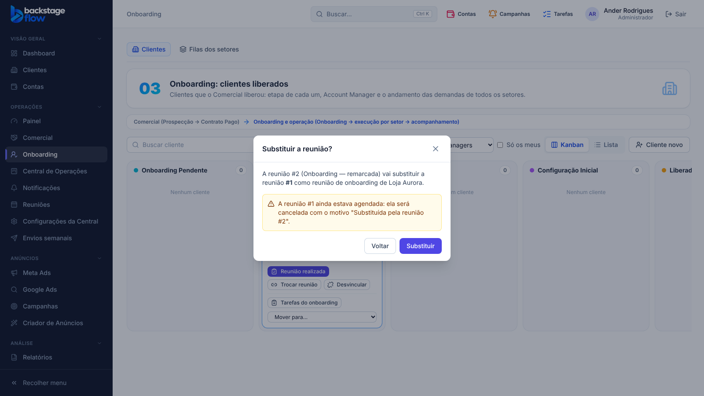

# 51.5 — "Trocar reunião" no cartão do Onboarding (07/11/2026)

## Pedido do Ander
Quando o cartão já tem reunião, o "Criar reunião" fica dentro de "Trocar reunião". Ao trocar (por uma reunião existente ou uma nova), um pop-up avisa que a nova substitui a anterior, e a anterior é finalizada com a observação de que foi substituída. Escolha do Ander: **(a)** se a anterior ainda estava agendada, ela vira **Cancelada** com esse motivo.

## O que mudou
- Cartão **sem** reunião: continuam "Vincular reunião" e "Criar reunião".
- Cartão **com** reunião: "Reunião realizada" (se agendada), **"Trocar reunião"** e "Desvincular". Não há mais "Criar reunião" solto.
- "Trocar reunião" abre uma janela com duas opções:
  - **Usar uma reunião já criada** (lista as reuniões do cliente) → "Usar esta reunião";
  - **Criar reunião nova** → abre o formulário "Nova reunião" já com o cliente e o título "Onboarding — <cliente>".
- Antes de trocar, o pop-up **"Substituir a reunião?"** explica o que acontece com a anterior:
  - estava **agendada** → é **cancelada** com o motivo "Substituída pela reunião #N em dd/mm/aaaa hh:mm.";
  - já estava **finalizada** (realizada) → a situação não muda; a mesma frase é acrescentada na ata.
- O cliente **não muda de coluna** com a troca (as regras de passagem continuam as mesmas).
- Histórico do cliente: "Reunião substituída — Reunião #A → #B". Histórico da reunião anterior: cancelamento com o motivo.
- Quem pode: o mesmo de vincular reunião (Account Manager do cliente, gestor/admin, conforme as permissões do banco). Criar a reunião nova exige "Criar reuniões e Dailies".

## Banco
- Migração `20261107222038_onboarding_substituir_reuniao.sql`: função `ops_client_meeting_replace(cliente, reunião)` (fina) → `private.ops_client_meeting_replace_impl` (confere as permissões pela mesma regra de vincular).
- Sem tabela nova. Recusa trocar pela mesma reunião ou por uma reunião cancelada.
- Script de remoção (`supabase/rollback/remover_central_operacoes.sql`) atualizado.

## Testes
- SQL (transação desfeita): 4 verificações OK (agendada → cancelada e cliente na mesma coluna; realizada mantém a situação e ganha a nota; mesma reunião e reunião cancelada recusadas; 2 registros no histórico).
- Navegador `onboarding-trocar-reuniao.mjs` (novo, 8 verificações) e, de novo, `onboarding-reuniao` (35), `onboarding-reuniao-realizada` (6), `onboarding-ficha` (23), `ops-clients` (41), `ops-meetings` (31).
- Tipos e lint OK.
