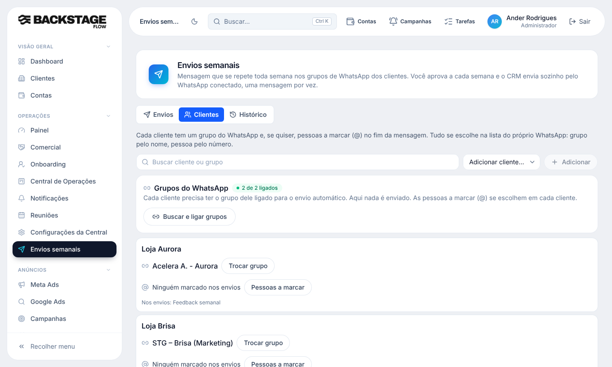
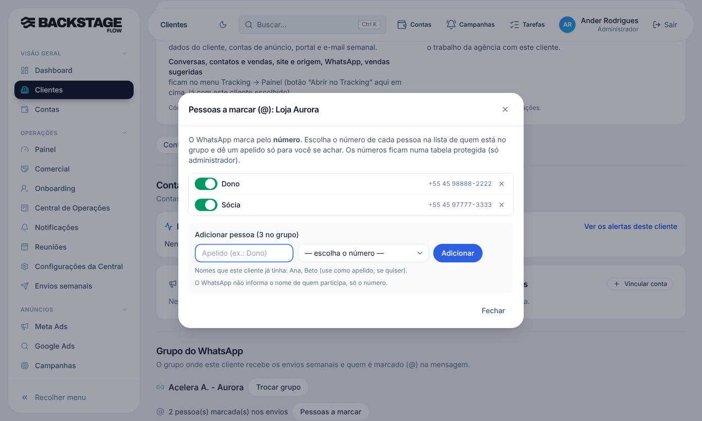

# T5.22 · Fase 1 — Aba "Clientes" e marcação (@) só por número (09/11/2026)

## O que mudou para você
- A aba **"Grupos e @ dos clientes"** virou **"Clientes"**. Cada cliente mostra o **grupo ligado** (escolhido na lista do WhatsApp) e as **pessoas a marcar**.
- As pessoas a marcar agora são **sempre por número**: você escolhe o número na lista de quem está no grupo e dá um **apelido** (só para você se achar). Dá para **ligar/desligar** a marcação de cada pessoa sem apagar o número, ou tirar a pessoa.
- **Sumiu o jeito antigo**: campo para digitar o nome do grupo, chaves de "@nome", "Copiar comando", "Instrução da tarefa" e os textos sobre Claude/MCP enviando. O envio pede só nome, mensagem, dia, horário e a lista de clientes.
- **Adicionar cliente** abre a lista de grupos do WhatsApp; ao salvar, o cliente entra nos envios com o nome do grupo escolhido.
- O pop-up de aprovação mostra só **cliente e grupo** (sem @nome).
- O **Claude/MCP não envia mais nem registra "enviado"**: o banco recusa. As ferramentas de envios no MCP ficam só para consultar (e registrar falhou/pulado). O texto do guia do MCP foi atualizado no código, **mas a função `mcp` ainda não foi publicada** (vai junto com a Fase 2).

## Banco (já aplicado no Supabase)
- `wa_marcacoes.ativo` (liga/desliga sem apagar); nome livre (apelido); número repetido para outra pessoa do mesmo cliente é recusado.
- `wa_marcacao_ativar(cliente, nome, ativo)` (só administrador). `wa_marcacoes_do_envio` agora devolve os números **ativos** do cliente, na ordem de cadastro.
- `envio_situacao.pode_enviar_agora` fica sempre falso; `ops_envio_execucao_add` recusa "enviado" vindo do MCP.
- Nenhuma tabela nova nesta fase. `wa_marcacoes` continua protegida (só administrador lê e muda; guardada até o administrador remover).
- Migrações: `20261109110000_envios_organizar_arrobas_por_numero.sql`, `20261109110100_envio_mcp_nao_registra_enviado.sql`.

## Testes
- SQL (transação desfeita): `wa_marcacoes_arrobas.sql` (8 verificações OK), `etapa41_2_envios_aprovacao.sql` (6 OK), todos rodados no banco real.
- Funções (Deno): 210 passaram. Unitários: 287 passaram. Tipos, lint e segredos: limpos.
- Navegador (simulado): `wa-marcacoes`, `ops-envios`, `ops-envios-padroes`, `ops-envios-aprovacao`, `wa-grupos`, `wa-disparos` passaram. A suíte completa dos testes de navegador **não** foi rodada de novo nesta fase.
- **Não testado:** a marcação real no WhatsApp (ainda falta escolher números e enviar para um grupo de teste).

