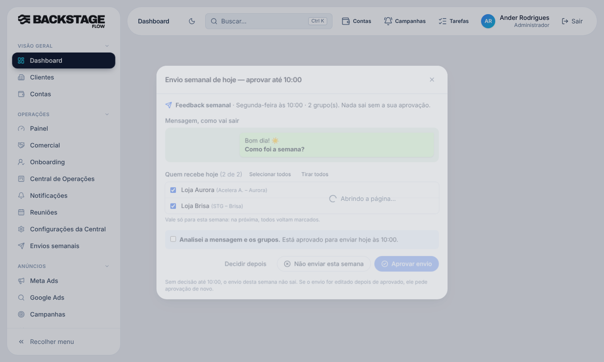

# T5.22 · Fase 2 — "Quem recebe hoje" (09/11/2026)

## O que mudou para você
- No pop-up (e no cartão) de aprovação do envio aparece a lista **"Quem recebe hoje (N de M)"**, com uma caixinha por cliente. **Todos vêm marcados**; desmarque quem não deve receber **nesta semana**. Há "Selecionar todos" e "Tirar todos".
- A escolha é gravada ao **aprovar** e vale **só para a semana atual**: na semana seguinte todos voltam marcados.
- Sem nenhum cliente marcado não dá para aprovar.
- Quem foi desmarcado **sai da fila automática**. Se você marcar de novo, volta para a fila. No cartão do envio aparece "fora desta semana".
- Mudar quem recebe **não** muda a versão do envio: a aprovação continua valendo.

## Banco (já aplicado no Supabase)
**Tabela nova `ops_envio_semana_clientes`**
- Para quê: guardar, por semana, quais clientes **não** recebem um envio (só as exceções ao padrão "todos recebem").
- Campos: envio, cliente, semana (segunda-feira, Brasília), `receber`, quem escolheu e quando.
- Ligações: `ops_envios`, `clients`, `auth.users`. Única por (envio, cliente, semana).
- Índices: semana, cliente, quem escolheu.
- Quem vê: quem tem a permissão "Envios semanais" (RLS); só grava pela função `ops_envio_semana_set` (conferida no banco).
- Guardada **sem prazo** (é histórico de quem recebeu o quê).

Também: `wa_envios_enfileirar` pula os desmarcados; `ops_envio_semana_set` tira da fila o que ainda estava pendente (marca "Desmarcado para esta semana.", sem apagar nada); `envio_json` devolve `recebe_hoje` por cliente. Migração `20261109120000_envio_quem_recebe_na_semana.sql`.

## Testes
- SQL `etapa_t522_quem_recebe.sql`: 7 verificações OK no banco real (transação desfeita): padrão, desmarcar, cliente de fora recusado, sem permissão recusado, fila pula o desmarcado, marcar de novo volta à fila, semana nova volta ao padrão.
- Navegador (simulado): `ops-envios-aprovacao` (inclui a nova escolha), `ops-envios`, `ops-envios-padroes`, `wa-marcacoes`, `wa-disparos`, `hoje` passaram.
- **Não testado:** envio real a vários clientes com alguns desmarcados.

