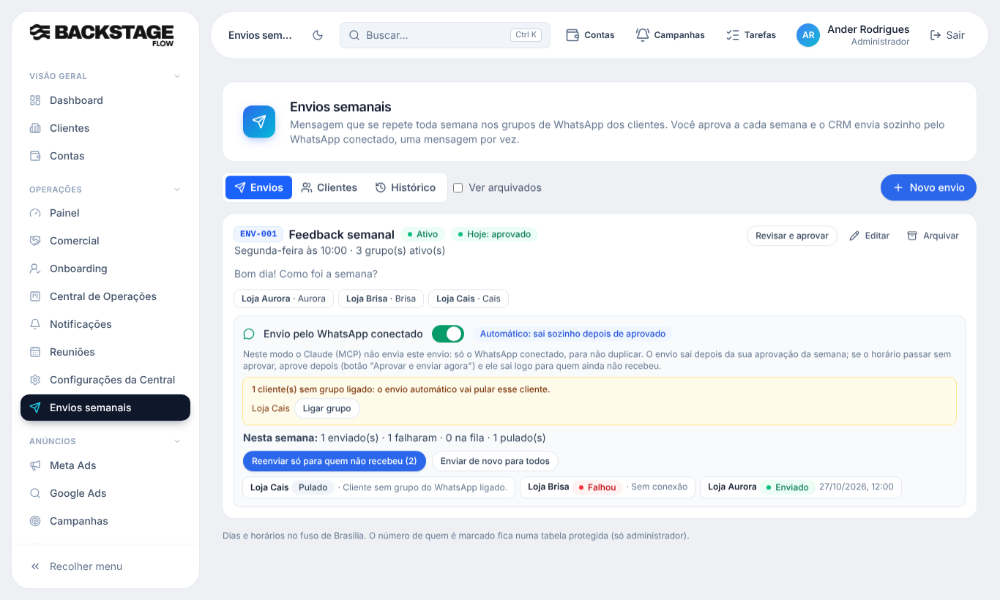

# T5.22 · Fase 3 — Resumo da semana e reenvio (09/11/2026)

## O que mudou para você
- No painel de cada envio automático aparece o resumo: **"Nesta semana: N enviados · N falharam · N na fila · N pulados"** (último resultado de cada cliente).
- Dois botões (só administrador, com o envio automático ligado e **aprovado na semana**):
  - **Reenviar só para quem não recebeu** (o padrão): coloca na fila quem falhou ou foi pulado, e mostra quantos faltam.
  - **Enviar de novo para todos**: pede **confirmação** e avisa que quem já recebeu vai receber de novo (duplicado no grupo).
- O reenvio usa a mesma fila do envio automático: um por vez, 45 segundos entre mensagens, limite de 60 por dia. Quem foi desmarcado em "Quem recebe hoje" não entra. Cliente já na fila não duplica. Cliente sem grupo ligado é contado e pulado.
- Não muda o dia nem o horário do envio; exige a aprovação da semana válida.

## Banco (já aplicado)
- Função `wa_envio_reenviar(envio, modo)` (permissão de Envios, conferida no banco; registra em `audit_logs`). Sem tabela nova: usa `wa_disparos` (origem "manual" = pedido pelo CRM) e o histórico de execuções de sempre. Migração `20261109130000_envio_reenviar.sql`.

## Testes
- SQL `etapa_t522_reenviar.sql`: 6 verificações OK no banco real (transação desfeita): recusa sem ser automático / sem aprovação; só faltantes; sem duplicar; todos; desmarcado não entra.
- Navegador (simulado): resumo, reenvio dos faltantes, confirmação de "todos" (cancelar não envia, confirmar envia). Testes de envios, aprovação, marcações, clientes e grupos passaram; tipos, lint, segredos e 287 unitários limpos.
- **Não testado:** reenvio real no WhatsApp.

