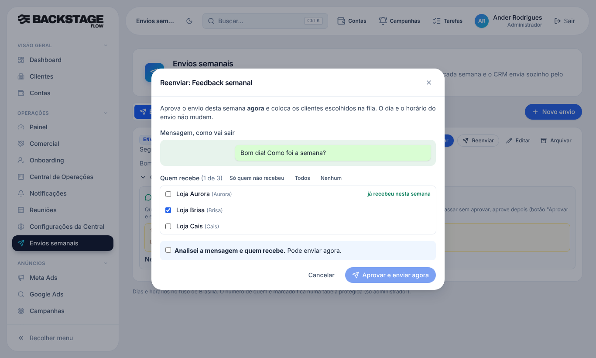

# T5.25 · Botão "Reenviar" no cartão do envio (10/11/2026)

## O que mudou para você
- Todo envio **automático e ativo** ganha o botão **"Reenviar"** no cartão (ao lado de "Editar"). Ele abre direto a tela de aprovar e enviar — **sem precisar trocar o horário** do envio antes.
- A tela mostra a mensagem como vai sair e a lista de clientes. **Já vêm marcados só os que ainda não receberam nesta semana.** Atalhos: "Só quem não recebeu", "Todos", "Nenhum".
- Marcar quem já recebeu é possível, de propósito: aparece o aviso de que a mensagem vai **duplicar no grupo**.
- Marcar "Analisei a mensagem e quem recebe" e clicar em **"Aprovar e enviar agora"**: aprova a semana e coloca os escolhidos na fila (um grupo por vez, 45 s entre as mensagens, limite de 60 por dia).
- O dia e o horário do envio **não mudam**; na próxima semana ele volta ao normal. Quem não foi marcado fica fora **desta semana** (a fila automática também respeita).
- Se o envio foi editado depois que você abriu a tela, ele recusa e pede para conferir de novo.

## Banco (já aplicado)
- Função `ops_envio_reenviar_agora(envio, versão, clientes)` (permissão de Envios, conferida no banco; registra em `audit_logs` quem reenviou e quantos). Sem tabela nova: usa `ops_envio_aprovacoes`, `ops_envio_semana_clientes` e `wa_disparos` (origem "manual"). Migração `20261110100000_envio_reenviar_agora.sql`.

## Testes
- SQL no banco real (transação desfeita): 6 verificações OK — recusa envio não automático; recusa versão velha; aprova e enfileira só o escolhido; a fila automática não manda para o desmarcado; o envio sai na fila; quem já recebeu entra de novo só se escolhido.
- Navegador (simulado): botão, marcação padrão, aviso de duplicidade, trava do "Analisei", envio só para o escolhido, horário inalterado. Tipos, lint, segredos e 283 testes unitários limpos.
- **Não testado:** envio real no WhatsApp.

