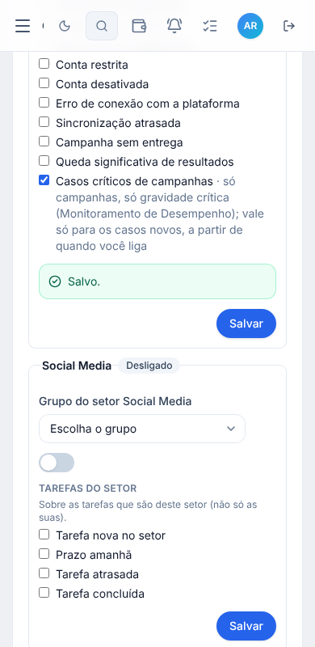

# T5.38 — Avisos no WhatsApp por setor

## O que você ganhou
Em **Integrações → Avisos no WhatsApp por setor**, o administrador coloca **um grupo de WhatsApp para cada setor** e escolhe quais avisos aquele grupo recebe. **Setor novo aparece sozinho** na lista (basta escolher o grupo). O grupo de avisos que já existia (o seu) **continua igual**.

## Quais avisos cada setor tem
| Setor | Avisos |
|---|---|
| **Todos os setores** | Tarefas **do setor**: tarefa nova, prazo amanhã, atrasada, concluída |
| **Gestão de Tráfego** | Tudo acima **mais** os alertas das contas (sem saldo, saldo baixo, conta restrita/desativada, pagamento pendente, cobrança, sem forma de pagamento, sincronização atrasada, erro de conexão, campanha sem entrega, queda de resultados) e os **casos críticos de campanhas** |
| **Account Manager** | Tudo de tarefas **mais** o **onboarding**: cliente entrou no fluxo, mudou de etapa, reunião de onboarding marcada |
| **Comercial** | Tudo de tarefas **mais** os **leads**: lead novo, ganho (contrato pago), perdido |
| **Design, Copy, Dev e os novos** | Só as tarefas do setor |

Campanhas e contas **só** chegam ao grupo da Gestão de Tráfego; onboarding **só** ao Account Manager; leads **só** ao Comercial (o banco recusa essas opções nos outros setores). O "cliente sem gastar" e a "última chamada do envio semanal" continuam **só no seu grupo principal**.

## Regras
- **Só os avisos novos:** vale a partir de quando o setor é ligado (ou quando um tipo é acrescentado). O que já existia não é enviado.
- **Um grupo por mensagem:** cada mensagem vai para um grupo só; vários avisos do mesmo grupo viram uma mensagem. Silêncio (o mesmo do grupo principal), 1 mensagem a cada 2 min e no máximo 40 por dia **por grupo**; aviso com mais de 24 h é descartado.
- Subtarefas não geram "tarefa nova" (só a principal); prazo e atraso valem para todas.
- Leads: só o **nome da empresa** vai na mensagem; telefone, e-mail e contato **nunca** saem do CRM.
- Só o administrador configura (o Account Manager poderá receber essa permissão depois).

## Tabelas
- **`wa_avisos_setores`** (nova): uma linha por setor. Para quê: grupo e avisos de cada setor. Campos: setor (liga a `ops_sectors`), ligado, grupo (id e nome), lista de tipos, "avisa a partir de", quem mudou e quando. Índice em quem mudou. Guardada permanentemente. RLS: só o administrador lê; escreve só pela função `wa_avisos_setor_save`.
- **`wa_avisos`** ganhou a coluna `grupo_id` (para qual grupo o aviso vai; vazio = grupo principal).

## Testes
- Banco (`supabase/tests/wa_avisos_por_setor.sql`, desfeito no fim): **14 de 14** (opções por setor recusadas nos setores errados, só administrador, aviso de tarefa vai ao grupo do Design, campanha só ao grupo do gestor, lead só ao Comercial, etapa só ao Account Manager, nada vaza para o grupo principal, não repete na segunda rodada, o envio separa por grupo). Avisos de segurança do Supabase: nenhum novo.
- Navegador (`e2e/wa-avisos-setores.mjs`): opções certas em cada setor, ligar sem grupo recusado, salvar, recarregar, gestor não vê o cartão; `wa-avisos` e `organizacao` continuam passando. Tipos, lint e testes unitários passaram. Celular (390 px) sem corte.
- **Não testado:** mensagem real chegando em um grupo de setor (depende de um grupo escolhido e de um evento novo).

## Arquivos
`supabase/migrations/20261116100000_wa_avisos_por_setor.sql` (aplicada), `WaAvisosSetoresCard.tsx`, `waAvisosApi.ts`, `IntegrationsPage.tsx`, simulador `mockWaGateway.js`, testes.
