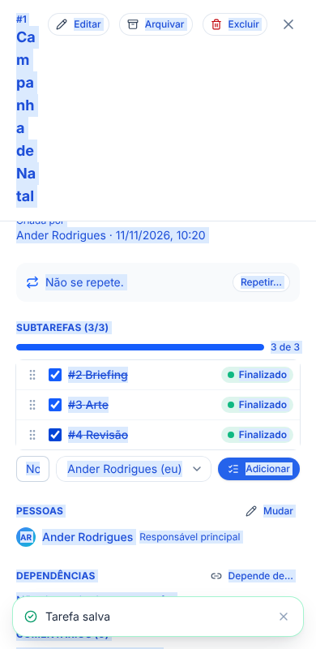

# T5.32 — Subtarefas, etapa 2 de 6: tela da tarefa

## O que você ganhou
Dentro de qualquer tarefa agora existe a seção **Subtarefas**: você quebra a tarefa em passos menores, vê o progresso ("2 de 3") e marca cada passo como concluído sem sair da tela.

## Como funciona
- **Criar:** digite o título e aperte Enter. A subtarefa nasce com o setor, o cliente, a prioridade e quem pode ver da tarefa principal. O **responsável é obrigatório** (já vem você; dá para trocar na caixinha ao lado).
- **Progresso:** barra azul e "X de Y".
- **Concluir/reabrir:** caixinha ao lado de cada subtarefa.
- **Ordem:** arraste pela alça ⠿ (mouse ou dedo). A ordem fica salva.
- **Abrir:** clique no título. Na subtarefa aparece "↳ parte de #N Título" no topo; clicar volta para a principal.
- **Um nível só:** subtarefa não tem subtarefas (a seção não aparece nela).
- **Finalizar a principal** só com todas as subtarefas concluídas; senão a tela explica quantas faltam.
- **Arquivar/excluir** a principal leva as subtarefas junto.
- **Histórico** da principal registra "Criou uma subtarefa", "Incluiu" e "Retirou".
- Subtarefa de outro setor que você não enxerga aparece como "(subtarefa de outro setor)", só contando no progresso.

## Quem pode
Quem pode editar a tarefa cria e reordena; quem pode mexer no status conclui. As regras são conferidas no banco (etapa 1).

## Tabelas novas
Nenhuma (usa `ops_tasks` e as funções da etapa 1).

## Testes
- Navegador (`e2e/ops-subtarefas.mjs`, simulador): criar com Enter, setor/responsável herdados, título curto e sem responsável recusados, bloqueio de finalizar, progresso, arrastar, abrir/voltar, um nível, finalizar ao concluir tudo, histórico, arquivar em cascata. Tudo passou.
- Celular (390 px): sem texto cortado na tela da tarefa (só o fundo decorativo do login, antigo e inofensivo).
- Regressão: ops-tasks, ops-clients, onboarding-reuniao e onboarding de tarefas padrão passaram.
- **Não testado:** com o banco real pela tela (o simulador reproduz as regras; o banco já foi testado na etapa 1) e em celular de verdade.

## Arquivos
`tasksApi.ts` (tipos + `useReorderSubtasks`), `TaskDetail.tsx` (seção e aviso "parte de"), `activity.ts` (nomes no histórico), `demo/mockOpsTasks.js`, `e2e/ops-subtarefas.mjs`.

## Próxima etapa (3): Kanban, Minhas tarefas e filas com selo "▸ 2/5", filtro "só principais" e "↳ de #N".
