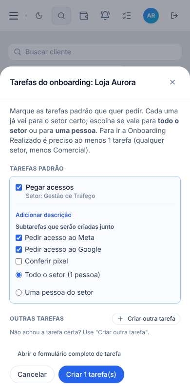

# T5.32 — Subtarefas, etapa 5 de 6: Onboarding

## O que você ganhou
- Cada **tarefa padrão do onboarding** pode ter **subtarefas padrão** (Configurações da Central → Tarefas padrão do onboarding → campo "Subtarefas padrão", uma por linha, até 20).
- No cartão do cliente, ao marcar a tarefa padrão aparecem as subtarefas dela, **todas marcadas**; desmarque as que não quer. Ao criar, a tarefa e as subtarefas escolhidas nascem juntas, com o cliente, o setor e o responsável principal da tarefa.
- O **cartão do cliente** (Onboarding / Clientes) mostra **▸ 2/5 subtarefas** (concluídas / total).

## Regras
- Subtarefa padrão: 3 a 200 letras; linhas vazias são ignoradas.
- Subtarefas não contam como "obrigatórias" para o cliente avançar de etapa (só a tarefa principal conta, como antes) e não mudam as contas "abertas/atrasadas" do cartão, que já incluem todas as tarefas do cliente.
- Quem configura os modelos: só admin (igual antes).

## Tabela alterada
`ops_onboarding_task_templates` ganhou a coluna `subtasks` (lista de títulos, até 20, padrão vazia). Para quê: subtarefas oferecidas com a tarefa padrão. Ligações: nenhuma nova. Índices: nenhum novo. Guardada enquanto o modelo existir (desativar não apaga). RLS: a mesma (leitura para quem acessa a Central; gravação só pela função do admin).
Funções: `ops_onboarding_template_save` aceita `subtasks`; o resumo do cliente (`ops_client_summary`) ganhou `subtarefas` e `subtarefas_concluidas`.

## Testes
- Banco (`supabase/tests/etapa_t532_5_subtarefas_padrao.sql`, desfeito no fim): 5 de 5 (salva, recusa título curto, limpa, contagem do resumo antes/depois de concluir). Avisos de segurança do Supabase: nenhum novo.
- Navegador (`e2e/ops-onboarding-subtarefas.mjs`, simulador): cadastro do modelo, recusa de curta, marcar tarefa e desmarcar uma subtarefa, criação com herança, progresso 0/2 e 1/2 no cartão. Passou; regressão (onboarding-reuniao, subtarefas, config, clientes) passou.
- **Não testado:** tela com banco real; celular de verdade.

## Arquivos
`supabase/migrations/20261111200000_onboarding_subtarefas_padrao.sql`, `onboardingTemplatesApi.ts`, `OnboardingTemplatesSettings.tsx`, `OnboardingTasksModal.tsx`, `ClientsPage.tsx`, `clientsApi.ts`, `demo/mockOpsTasks.js`, `e2e/ops-onboarding-subtarefas.mjs`.

## Próxima etapa (6): MCP (ferramentas conhecem subtarefas), repetição de tarefas copiando subtarefas, acabamento e documentação final.
