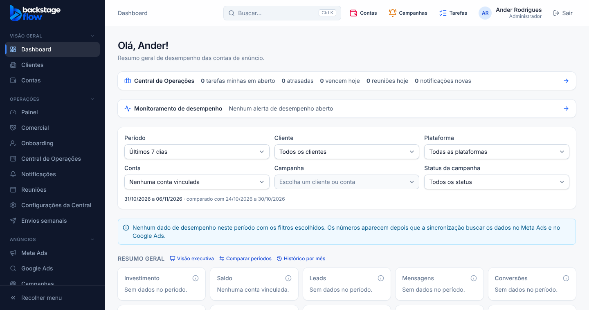
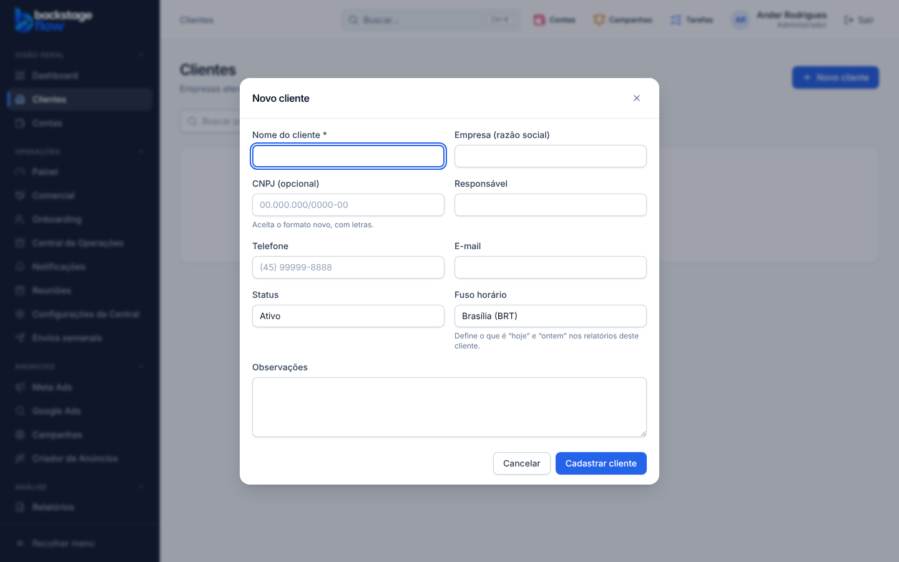

# 52.1 — Design System (07/11/2026)

> Branch `ui-premium-redesign`. **Nenhuma migração, nenhum banco, nenhuma regra de negócio, nenhum cálculo alterado.** Só aparência e componentes compartilhados.

## O que mudou

### Cores (um azul só)
- A cor `brand` deixou de ser anil (`#4f46e5`) e passou a ser a **escala de azul** (`#2563eb` como principal). Como a Central já usava o azul do Tailwind, **o sistema inteiro passa a ter um azul só**, trocado em um lugar (`src/index.css`).
- Ciano (`accent`) criado para detalhes (logo, item ativo do menu, gráficos); ainda não aplicado.
- Fundo da página: cinza muito claro `#f7f8fa`. Duas sombras padrão: `shadow-card` (suave) e `shadow-elevated` (janelas e avisos). Mais uma de brilho azul só no botão principal ao passar o mouse.
- Caixas de seleção e opções (checkbox/radio) na cor da marca.

### Componentes (`src/components/ui`)
| Componente | O que mudou |
|---|---|
| `Button` | Tamanhos `sm`/`md`/`lg` e variante nova `subtle` (azul claro). Estados: mouse, clique (afunda), carregando (`aria-busy`), desabilitado. As telas que já ajustavam o botão à mão continuam iguais. |
| `IconButton` (novo) | Botão só de ícone: área 32/36 px, **dica com o nome** (obrigatório), feedback ao clicar. Já usado no "X" das janelas. |
| `StatusBadge` (novo) | Selo único com pontinho: Ativo e Concluído (verde), Pendente e Atenção (âmbar), Em andamento (azul-céu), Erro e Atrasado (vermelho), Pausado e Encerrado (cinza). Será aplicado nos módulos nas fases 52.4 a 52.6. |
| `Card` | Sombra suave e borda discreta. |
| `Input` / `Select` / `Textarea` | Sombra leve, borda que escurece ao passar o mouse, foco azul; **seta própria nos selects** (continuam nativos, seguros no celular e nos testes). |
| `Modal` | Entra com fade e leve zoom (computador) ou sobe de baixo (celular), 150–220 ms; cantos de 16 px; botão de fechar padronizado. |
| `Skeleton` (novo) | Esqueleto com brilho suave (parado em "reduzir movimento"). |
| **Avisos rápidos** (novo) | `toast.success/error/info(...)` e `<ToastViewport />` (montado no início do app): canto da tela, fecham sozinhos (4 s; erro 7 s), no máximo 4, mensagem repetida não empilha, botão de fechar, leitor de tela. **Ainda não estão ligados a nenhuma ação:** serão usados nas fases dos módulos (por exemplo "Salvo!"). |

### Movimento
Só CSS, sem biblioteca nova. Transições de 150–220 ms, **sem animações em loop** (o brilho do esqueleto é a única, e fica parado em "reduzir movimento").

## Testes
- Tipos e lint OK; unitários OK (inclui 3 novos dos avisos rápidos); `check:secrets` OK.
- **Suíte completa de navegador (92 arquivos):** 91 passam. O `client-report` falhou na primeira rodada: o desfoque do fundo das janelas atrasava a tela no navegador de teste (e pesaria em celulares fracos). **Retirei o desfoque**; depois disso passou 3 de 3. O `wa-grupos` falhou uma vez e passou na repetição (instabilidade já conhecida).
- **Não testado:** em celular de verdade.
