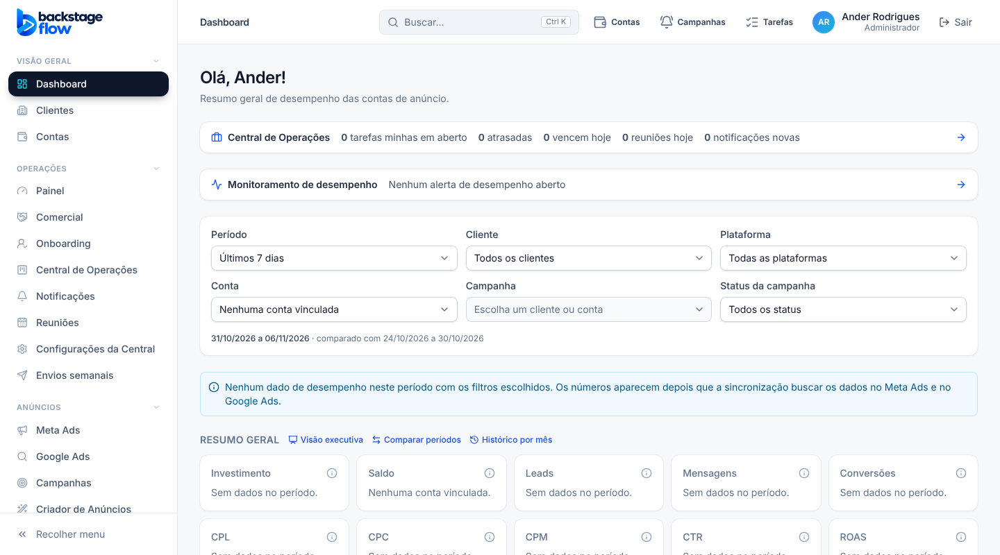
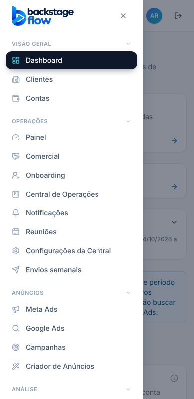

# 52.2 — Menu lateral e cabeçalho (08/11/2026)

> Branch `ui-premium-redesign`. Sem migração, sem banco, sem mudança de rotas, permissões ou ordem do menu. Direção escolhida com base nas referências do Ander (Dashboard V21/V14): menu **claro**, item ativo em **pílula escura**.

## O que mudou
- **Menu lateral claro:** fundo branco com borda fina; grupos em cinza discreto; itens com cantos arredondados; **item ativo em pílula escura** com sombra e ícone em ciano (a marca). Mesmos grupos, mesma ordem, mesmo botão de recolher, mesmo contador vermelho de Alertas e submenu dos 3 assuntos.
- **Logo** na versão para fundo claro.
- **Gaveta do celular:** também clara, entra deslizando; botão de fechar padronizado.
- **Cabeçalho:** título da seção em destaque; os três atalhos (Contas, Campanhas, Tarefas) agora com o **mesmo tom** (ícones diferentes e nomes visíveis; contador vermelho só quando há aviso); avatar com degradê azul→ciano; botões com cantos e hover consistentes.
- **Troca de tela com fade curto** (240 ms), desligado em "reduzir movimento" e na impressão.

## Defeito encontrado e corrigido no caminho
Na primeira versão da troca de tela, 4 testes de navegador (`contacts`, `monitoring-critical`, `sales-webhooks`, `wa-phrases`) falharam: as **janelas** apareciam deslocadas. Causa: com a animação deixando a página "transformada", o navegador usava a página (e não a tela) como referência das janelas. Corrigido (a animação só atua enquanto roda); os 4 passaram.

## Testes
Tipos, lint, unitários, `check:secrets` OK. Navegador: suíte completa rodada (87 OK antes do ajuste + os 4 afetados e mais 9 de regressão rodados de novo, todos OK). **Não testado:** em celular de verdade.
