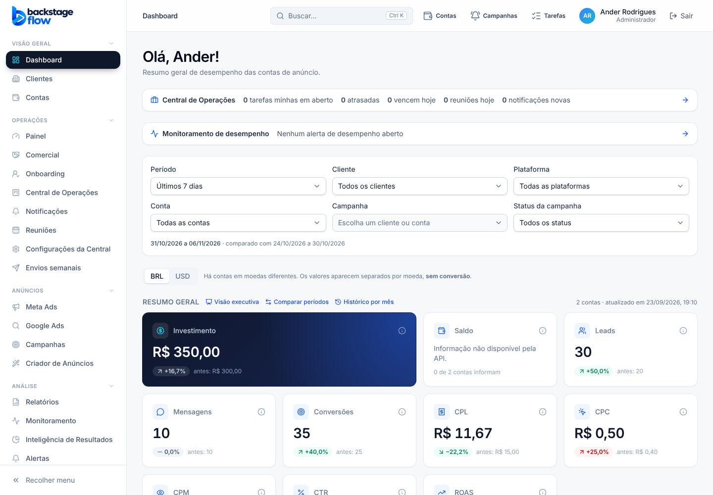
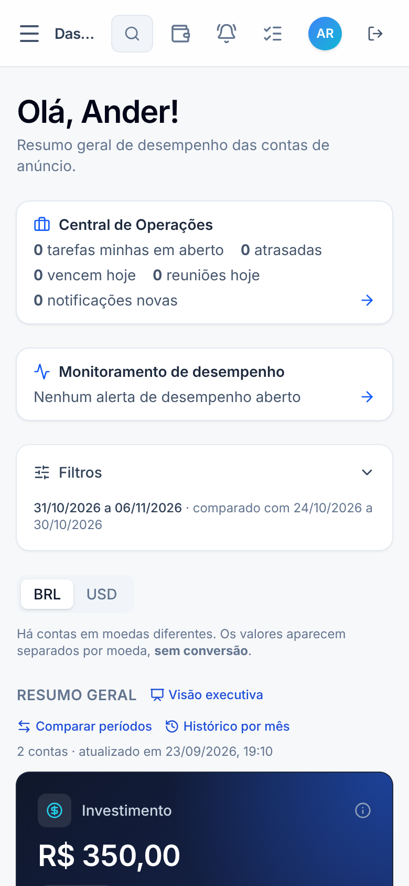

# 52.3 — Dashboard (08/11/2026)

> Branch `ui-premium-redesign` (**não publicada**, a pedido do Ander: publicar depois do Dashboard). **Só aparência.** Nenhuma consulta, fórmula, filtro, período, moeda ou regra de saldo foi tocada. Sem banco e sem migração.

## O que mudou
- **Indicadores (`KpiCard`):** ícone em cada um; **número grande** (28 px, algarismos alinhados); variação em **pílula** verde/vermelha; "antes" em linha discreta; cantos e respiro maiores; ao passar o mouse o cartão **sobe** com sombra. Mesmos 10 indicadores, mesmos números e textos de "sem dados" / "Informação não disponível pela API".
- **Investimento em destaque:** cartão **escuro** (azul-marinho com brilho azul no canto), ocupando 2 colunas, como na referência V21. Os demais seguem claros.
- **Entrada em sequência:** os cartões aparecem em cascata (45 ms entre um e outro).
- **Gráfico de evolução:** linha mais firme, **área com degradê azul**, grade tracejada leve, tooltip mais elegante; a **linha se desenha** ao abrir e a área surge depois. Controle "Diário/Semanal/Mensal" mais bonito. Mesmos dados, mesma legenda, mesma tabela alternativa.
- **Filtros:** em tela muito larga (≥ 1536 px) os 6 filtros ficam **numa linha só**; no celular continua recolhido atrás de "Filtros".
- **Título maior** ("Olá, Ander!") e cartão do gráfico com entrada suave.
- Tudo desligado em "reduzir movimento".

## O que NÃO fiz (de propósito)
- **Contagem animada dos números** (0 → valor): números financeiros passando por valores falsos na tela e nos testes não combinam com "nunca inventar dados". Os números aparecem já corretos.
- **Mini-gráficos (sparklines) em cada indicador:** exigiriam uma consulta por indicador, o que seu prompt proíbe ("sem consultas extras só para efeito visual").
- **Rosca/gráficos novos das referências:** não há esses dados no Dashboard; não inventei.

## Testes
Tipos, lint, 182 + 275 unitários, `check:secrets` OK. Suíte completa de navegador: 90 OK; `google-agenda` falhou uma vez na suíte e passou 2 de 2 isolado (e passa no código antigo): instabilidade, não regressão. **Não testado:** celular de verdade.
