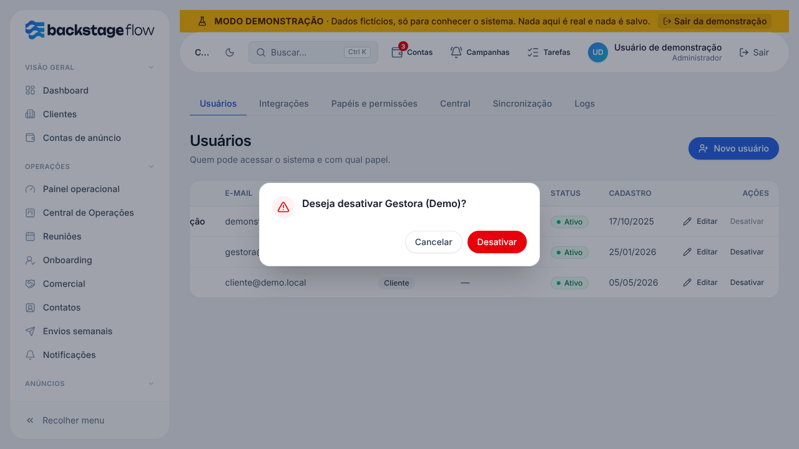

# Etapa 54.1 — Carregamento com esqueleto e confirmação no visual do sistema (22/11/2026)

Pedido do Ander: melhorar a experiência (análise imparcial) e começar pelas ideias **A** (carregamento) e **C** (retorno das ações).
Só tela: nada de banco, regra, rota ou permissão mudou.

## A. Carregamento com esqueleto
- Componentes novos em `components/ui/skeleton.tsx`: `TableSkeleton`, `ListSkeleton`, `ChatSkeleton`, `PageSkeleton`.
- **Só aparecem depois de 200 ms** (150 ms na troca de página): resposta rápida não pisca. Ocupam o espaço da tela para nada "pular".
- Leitores de tela ouvem "Carregando…" (role status). Tema escuro com cores próprias. Quem usa "reduzir movimento" vê o esqueleto parado.
- Aplicados em: troca de página (antes, círculo girando na tela toda; menu e cabeçalho agora ficam parados), Clientes, Ficha do cliente, Usuários, Campanhas, Saúde das contas, Contatos, Conversas do WhatsApp (lista e conversa), Central (Minhas tarefas, Tarefas, Painel, Filas, Arquivados, Onboarding, Comercial, Reuniões, Envios, Equipe), Alertas, Logs, Sincronização e Relatórios.
- Ficaram como estavam (blocos menores, pouco tempo na tela): partes dos Resultados, Tracking e configurações.

## C. Confirmação no visual do sistema
- As **26** perguntas com a janela padrão do navegador (cinza, diferente em cada navegador) viraram uma janela própria (`components/ui/confirm-dialog.tsx` + `lib/confirmStore.ts`).
- A pergunta vira título; a explicação fica embaixo; o botão leva o verbo ("Arquivar", "Desconectar", "Trocar"...). Ações difíceis de desfazer (apagar, desconectar, desativar, remover, trocar chave) ficam em **vermelho** com ícone de atenção.
- O foco começa em **Cancelar** (Enter sem pensar não apaga nada); Esc ou clicar fora cancela.
- Testes unitários novos (`confirmStore.test.ts`, 5 casos).

## Ainda não feito (fica para a próxima leva, se aprovado)
- Aviso com **"Desfazer"** ao arquivar e respostas instantâneas na tela (mover cartão, ligar chave) — mexe na lógica de cada ação, pede cuidado próprio.
- Reduzir a animação de entrada (o Ander não respondeu essa pergunta; nada foi mudado).

## Observações honestas
- Correção da análise: eram **26** janelas do navegador, não 4.
- O esqueleto não foi fotografado: no modo demonstração a resposta é rápida demais e ele (corretamente) não aparece.
- Achado à parte: em telas de 1280 px o título no cabeçalho aparece cortado ("C…"). Antigo, não corrigido aqui.
- `ops-clients.mjs` falha de vez em quando no arrastar do Kanban ("Copy finalizado pela fila"); acontece igual sem estas mudanças (conferido).

## Complemento (22/11/2026): aviso de retorno padronizado nas ações sérias
Pedido do Ander ("Faça o 1"): toda ação séria confirmada passa a dar um **aviso de retorno** no canto da tela (o mesmo componente de avisos que a Central já usava), em vez de só a linha sumir.
- Arquivar/remover/apagar/desconectar com aviso novo: contato arquivado, sistema de venda arquivado, formulário arquivado, frase arquivada, regra de monitoramento removida, regra do Tracking arquivada, regras publicadas, volta para versão N, conversa apagada, rascunho de campanha arquivado, conjunto removido do rascunho, conta desvinculada, conexão desconectada, chave da IA removida, usuário desativado/reativado.
- O texto sempre diz **o que aconteceu e o que continua guardado** ("O histórico continua guardado").
- Três `window.alert` do navegador (erro ao desativar usuário, ao desconectar e aviso ao vincular conta) viraram aviso do sistema (vermelho para erro).
- Telas que já mostravam retorno próprio (chaves de e-mail/planilha, WhatsApp conectar/desconectar, cliente desativado) ficaram como estavam.
- Achado durante o teste: o aviso de "conversa apagada" não aparecia quando posto na tela (a conversa sai da lista e a tela deixa de existir antes da resposta); foi para dentro da própria ação (`conversationsApi.ts`).
- **Não feito (depende do banco):** botão "Desfazer". Contato, rascunho e regra de monitoramento não têm "desarquivar" no banco e hoje não dá para aplicar mudança no Supabase (aprovação expira). Registrado em `docs/PENDENCIAS.md`.
